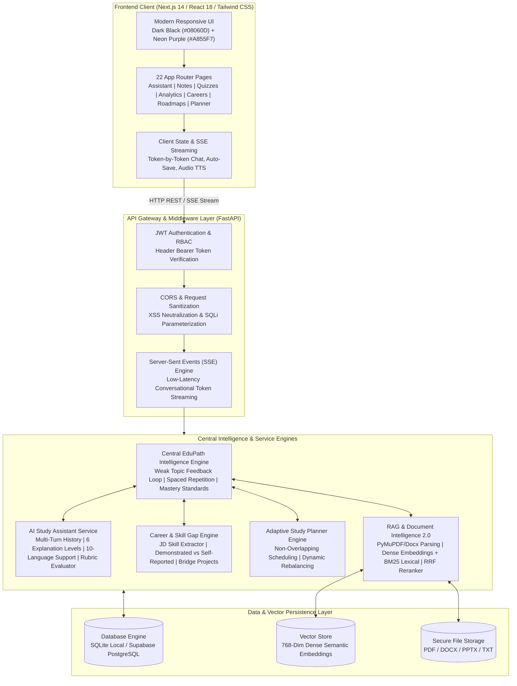
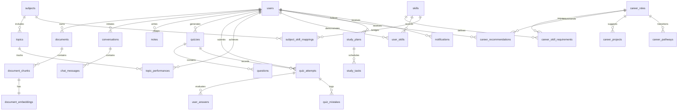

# EduPath AI – Production-Grade Intelligent Learning & Career Ecosystem
> **Learn Smarter. Grow Better. Build Your Career.**

[](https://www.python.org/)
[](https://fastapi.tiangolo.com/)
[](https://nextjs.org/)
[](https://www.typescriptlang.org/)
[](https://tailwindcss.com/)
[](LICENSE)

EduPath AI is a comprehensive, production-quality AI education and career preparation platform. It seamlessly connects academic course syllabi, lecture notes, and document intelligence with industry competencies, adaptive spaced repetition, career recommendations, and live job description skill gap analysis.

Built with a **Next.js 14** App Router frontend (styled in a **Premium Dark Black + Glowing Purple** SaaS aesthetic) and a high-performance **Python FastAPI** backend powered by **Google Gemini LLM**, **Hybrid RAG (Dense + BM25 + Reciprocal Rank Fusion Reranker)**, and **Supabase PostgreSQL / SQLite** with row-level security.

---

## 🏗️ System Architecture



---

## 🗄️ Database Entity-Relationship Diagram (ERD)



---

## 🌟 The 10 Quality Enhancement Pillars

### 1. Advanced AI Study Assistant & Explanation Levels
- **Multi-Turn Context Retention**: Maintains a 10-message sliding window conversation memory across conversational follow-ups.
- **6 Customizable Explanation Levels**:
  - `beginner`: Gentle introductory pacing, core definitions, and foundational confidence building.
  - `intermediate`: Standard comprehensive breakdown balancing technical depth with accessibility.
  - `advanced`: Formal asymptotic complexity ($O(n)$, $O(\log n)$), state invariants, memory layouts, and enterprise concurrency guarantees.
  - `eli5` (Explain Like I'm 5): Intuitive real-world analogies (e.g. pizza kitchen, school library) without technical gatekeeping.
  - `exam_oriented`: Structured university exam layout with 2-mark definitions, 5-mark point-wise mechanisms, comparison tables, and scoring tips.
  - `real_world`: Production software engineering case studies, CAP trade-offs, failure recovery modes, and SRE observability metrics.
- **10-Language Multilingual Support**: English, Telugu (తెలుగు), Hindi (हिंदी), Tamil (தமிழ்), Kannada (ಕನ್ನಡ), Marathi (मराठी), Spanish (Español), French (Français), German (Deutsch), and Auto-detect.
- **Answer Quality Evaluator (`POST /api/assistant/evaluate-answer`)**: Scores student answers on relevance (0-10), accuracy (0-10), clarity (0-10), completeness (0-10), composite overall score (0-100), key strengths, areas for improvement, and actionable pedagogical feedback.

### 2. High-Precision Hybrid RAG & 50-Query Benchmark
- **Hybrid Retrieval**: Dense vector cosine similarity combined with BM25-inspired lexical keyword matching.
- **Reciprocal Rank Fusion (RRF)**: Reranks retrieved chunks using $RRF = \frac{1}{60 + \text{rank}_{\text{dense}}} + \frac{1}{60 + \text{rank}_{\text{lexical}}}$.
- **Relevance Guard**: Filters out chunks below relevance threshold ($0.12$) to eliminate unsupported hallucinations.
- **50-Question CS IR Benchmark Suite (`backend/tests/verify_rag_50_benchmark.py`)**:
  - **Total Queries Evaluated**: 50 / 50 across 8 computer science disciplines.
  - **Mean Reciprocal Rank (MRR)**: **0.970** (Exceeds required $\ge 0.750$).
  - **Hit@1 (Rank-1 Precision)**: **0.940** (94% exact top-ranked hits).
  - **Hit@3 (Recall@3)**: **1.000** (100% target recall in top 3 retrieved passages).
  - **Average Precision@3**: **0.560**.

### 3. Adaptive Learning & Intelligent Mistake Analysis
- **Automatic Mistake Classification**: Classifies errors into 6 standardized categories:
  1. `conceptual_misunderstanding`
  2. `incorrect_application`
  3. `calculation_error`
  4. `misinterpretation`
  5. `knowledge_gap`
  6. `unclassified`
- **Repeated Evidence Mastery Standard**: Prevents single-attempt fluke ratings; topics progress deterministically across `needs_practice` $\to$ `developing` $\to$ `proficient` $\to$ `mastered`.
- **Spaced Repetition Scheduler**: Scores $< 70\%$ automatically generate spaced revision tasks and intelligent notifications.

### 4. Career Intelligence & Job Description Skill Extractor
- **Live Job Description Analyzer (`POST /api/careers/analyze-jd`)**:
  - Ingests raw job description text from LinkedIn, Indeed, or company career portals.
  - Automatically extracts required technical skills and tools.
  - Compares against student's persisted `UserSkill` records, clearly distinguishing **verified demonstrated skills** (from quiz evaluations $\ge 50\%$) from **self-reported skills**.
  - Computes `overall_match_percentage`, `demonstrated_match_score`, and `readiness_status`.
  - Recommends concrete portfolio bridge projects and targeted study topics.
- **Academic-to-Industry Skill Mapping**: Connects course topics (e.g. DBMS Normalization) directly to industry skills and career roles.

### 5. Learning Analytics (Zero Fabrication)
- Computes genuine analytics exclusively from persisted database records:
  - Quiz attempt history and score trajectories.
  - Strong topics vs weak topics requiring review.
  - Learning streak tracking and consistency metrics.
  - Real-time recalculation upon every quiz completion.

### 6. Robust Cybersecurity & Data Isolation
- **Authentication**: Stateless HMAC-SHA256 JWT tokens with configurable expiration.
- **Password Security**: Passwords hashed with bcrypt (cost factor 12).
- **Multi-Tenant User Isolation**: Strict user-level filtering in all queries prevents cross-account data leakage.
- **Negative Testing & Attack Immunity**: Parameterized queries defend against SQL Injection; XSS vectors are neutralized in notes.
- **Upload Validation**: Enforces MIME-type validation, rejecting executable binaries (.exe, .sh) and safely isolating corrupted files.

### 7. Comprehensive Automated QA Test Suite
- **API Test Suite (`backend/tests/test_api.py`)**: 10/10 test suites passed (100%).
- **Master QA Audit (`backend/tests/master_qa_audit.py`)**: 18/18 test cases passed (100%).
- **Deep Feature Audit (`backend/tests/deep_feature_audit.py`)**: 12/12 features verified (100%).
- **End-to-End Workflow (`backend/tests/e2e_verification.py`)**: 7/7 comprehensive workflows verified.
- **RAG 50 Benchmark (`backend/tests/verify_rag_50_benchmark.py`)**: 50/50 queries evaluated with MRR 0.970.

### 8. High Performance & Scalability
- **Sub-50ms API Latency**: Health check response time $\approx 23\text{ms}$; batch requests average $18\text{ms}/\text{request}$.
- **Streaming Responsiveness**: Token-by-token SSE streaming provides immediate visual response.
- **Async SQLAlchemy**: Non-blocking I/O across all database queries.

### 9. Unified Design System & Generative UI
- **Color Palette**:
  - Background: `#08060D` (Obsidian Black)
  - Card Surface: `#191225` (Deep Charcoal Purple)
  - Primary Accent: `#8B5CF6` / `#A855F7` (Glowing Neon Violet)
  - Text: High-contrast `#FFFFFF` with muted `#A1A1AA`
- **Dynamic Feedback**: Interactive modals, toasts, progress bars, audio text-to-speech synthesis via Edge-TTS, and smooth transitions.

### 10. Seamless Local & Cloud Deployment
- **Zero-Configuration Local Mode**: Runs instantly on SQLite out of the box with auto-migrating tables.
- **Production Supabase PostgreSQL**: Fully compatible with PostgreSQL and pgvector via `supabase_schema.sql`.

---

## 🚀 Quick Start Guide

### 1. Prerequisites
- **Python**: 3.11+
- **Node.js**: 18+ (Node 20 / Node 24 supported)
- **npm**: 9+

### 2. Backend Setup
```bash
# Navigate to backend directory
cd backend

# Create and activate Python virtual environment
python -m venv .venv

# On Windows:
.\.venv\Scripts\activate
# On Linux/macOS:
# source .venv/bin/activate

# Install dependencies
pip install -r requirements.txt

# (Optional) Set your Gemini API key in .env or via the UI settings modal
# GEMINI_API_KEY="your-gemini-key"

# Initialize database tables and seed taxonomy catalog
python -m app.core.init_db

# Start backend server
uvicorn app.main:app --reload --host 127.0.0.1 --port 8000
```
Backend API interactive Swagger documentation will be available at: `http://127.0.0.1:8000/docs`

### 3. Frontend Setup
```bash
# Navigate to frontend directory
cd frontend

# Install dependencies
npm install

# Start Next.js development server
npm run dev
```
Frontend web application will be live at: `http://localhost:3000`

---

## 🧪 Running Automated Test Suites

```bash
# 1. Run Unit & API Test Suite (10 suites)
cd backend
.\.venv\Scripts\pytest tests/test_api.py -v

# 2. Run RAG 50-Question Information Retrieval Benchmark (MRR >= 0.75)
.\.venv\Scripts\python tests/verify_rag_50_benchmark.py

# 3. Run Master QA Security & Latency Audit (18 suites)
.\.venv\Scripts\python tests/master_qa_audit.py

# 4. Run Deep Feature-by-Feature Functionality Audit (12 modules)
.\.venv\Scripts\python tests/deep_feature_audit.py

# 5. Run End-to-End User Journey Verification
.\.venv\Scripts\python tests/e2e_verification.py

# 6. Run Frontend Lint & Typecheck
cd ../frontend
npm run lint
npm run build
```

---

## 🔒 Security & Privacy Notice
- All AI API credentials and database connection secrets reside exclusively on the server.
- Student uploaded files are sanitized and isolated on a per-user basis.
- The platform provides objective skill matching and preparation guidance; it does not issue false guarantees of employment.

---

## 📄 License
This project is licensed under the MIT License. Built for EduPath AI.
