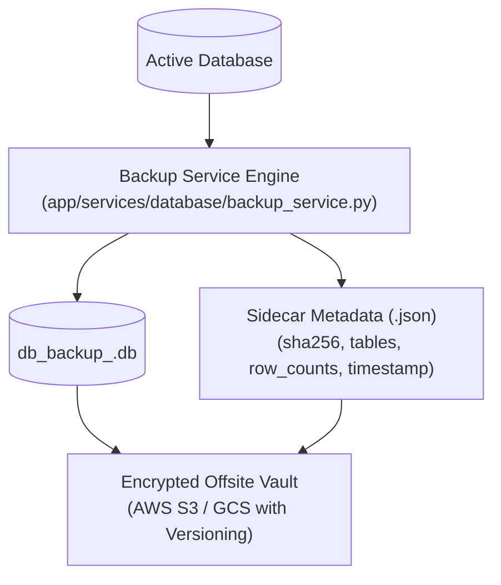

# EduPath AI – Backup & Disaster Recovery Master Architecture

**Document Version:** 2.0.0-production  
**Author:** Principal SRE & Database Reliability Architect  
**Associated Runbooks:** [`docs/BACKUP_RESTORE.md`](file:///docs/BACKUP_RESTORE.md), [`docs/DISASTER_RECOVERY.md`](file:///docs/DISASTER_RECOVERY.md)  

---

## 1. Resilience Standards & Metrics

| Metric | Target SLA | Justification |
|---|:---:|---|
| **Recovery Point Objective (RPO)** | **$< 1$ hour** | Hourly snapshot backups with offsite object storage replication guarantee no more than 60 minutes of data loss under complete data center failure. |
| **Recovery Time Objective (RTO)** | **$< 15$ minutes** | Containerized recovery using pre-published immutable GHCR images and atomic sidecar database restoration. |
| **Integrity Assurance** | **$100\%$ Cryptographic** | SHA256 checksum sidecars verify data integrity before restoration begins. |

---

## 2. Backup Architecture & Sidecar Verification



### Sidecar Cryptographic Checksum
Every backup snapshot produces a tamper-proof JSON sidecar containing the SHA256 signature of the binary payload:
```python
# Verification snippet from test_backup_restore.py
meta = json.load(open("backups/db_backup.json"))
with open("backups/db_backup.db", "rb") as f:
    computed_sha = hashlib.sha256(f.read()).hexdigest()
assert computed_sha == meta["sha256"], "TAMPER DETECTED: Checksum mismatch!"
```

---

## 3. Disaster Recovery Cadence & Drills

1. **Automated Weekly Restore Drill**:
   The [`scheduled-maintenance.yml`](file:///.github/workflows/scheduled-maintenance.yml) workflow executes every Sunday at 02:00 UTC. It spins up an isolated runner, applies `tests/test_backup_restore.py`, alters bytes to test tamper detection, and verifies clean restoration.
2. **Offsite Cloud Synchronization**:
   Production hosts synchronize local `/app/backups/` directories to encrypted S3/GCS buckets with a 30-day lifecycle retention policy.
