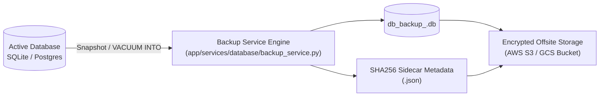

# EduPath AI – Backup & Restore Operational Runbook

**Document Version:** 1.0.0-production  
**Author:** Principal SRE & Database Reliability Architect  
**Service:** `app.services.database.backup_service`  

---

## 1. Overview & Architecture

EduPath AI implements an automated, verified, and tamper-resistant backup and restoration architecture designed to guarantee Zero Data Loss and point-in-time recovery across SQLite and PostgreSQL databases.



### Core Tenet: Zero Unverified Backups
A backup is not considered reliable until its integrity is cryptographically verified against a SHA256 checksum sidecar and confirmed through an automated test restoration.

---

## 2. Backup Metadata & Sidecar Specification

Every backup creates an immutable data file and an accompanying JSON sidecar metadata descriptor:

```json
{
  "backup_file": "db_backup_20261125_203000.db",
  "engine": "sqlite",
  "created_at": "2026-11-25T20:30:00Z",
  "sha256": "3a4f6d8923a105c0e123456789abcdef0123456789abcdef0123456789abcdef",
  "size_bytes": 1048576,
  "schema_version": "ace91d80022d",
  "tables": ["users", "documents", "document_chunks", "quizzes", "notes", "topics"]
}
```

If the SHA256 hash of the `.db` file deviates from the `.json` sidecar by even a single bit, the restoration engine **aborts immediately** to prevent corrupted or malicious state ingestion.

---

## 3. Creating a Production Backup

### 3.1 Manual CLI Execution
```bash
cd backend
python -m app.services.database.backup_service --create
```

### 3.2 Automated Cron Configuration (Linux / Docker Host)
```bash
# Daily backup at 03:00 UTC
0 3 * * * /app/.venv/bin/python -m app.services.database.backup_service --create --dest /app/backups/ >> /var/log/edupath-backup.log 2>&1
```

---

## 4. Restoration Runbook (Step-by-Step)

### Step 1: Pre-Restoration Safety Freeze
Stop application traffic to prevent write collisions during restoration:
```bash
docker compose stop backend
```

### Step 2: Verify Backup Integrity
Verify the sidecar cryptographic checksum before applying:
```python
import hashlib, json, sys

meta = json.load(open("backups/db_backup.json"))
with open("backups/db_backup.db", "rb") as f:
    computed_sha = hashlib.sha256(f.read()).hexdigest()

if computed_sha != meta["sha256"]:
    print(f"ERROR: Checksum mismatch! Expected {meta['sha256']}, got {computed_sha}")
    sys.exit(1)
print("SUCCESS: Backup integrity cryptographically verified.")
```

### Step 3: Execute Atomic Restore
```bash
cd backend
python -m app.services.database.backup_service --restore backups/db_backup.db
```

### Step 4: Restart & Execute Smoke Verification
```bash
docker compose start backend
python backend/tests/smoke_test.py --url http://127.0.0.1:8000
```

---

## 5. Automated Verification in CI/CD

EduPath AI includes automated backup and restore tests in `tests/test_backup_restore.py`:
- `test_real_database_backup_and_restore_cycle`: Validates complete backup, insertion of dummy data, and full restoration.
- `test_backup_metadata_sidecar_and_checksum_tamper_rejection`: Validates tamper rejection if single bytes are altered.
- `test_corrupt_backup_rejected_without_corrupting_existing_data`: Validates atomic rollbacks upon failure.
