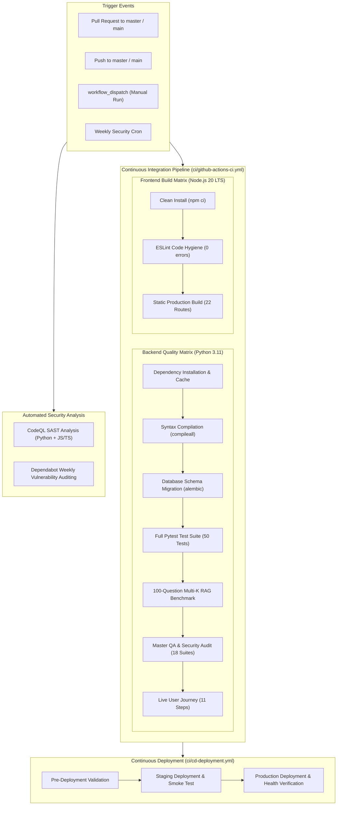

# EduPath AI — CI / CD Architecture & Automation Guide

## 1. Overview

EduPath AI employs an enterprise-grade Continuous Integration and Continuous Deployment (CI/CD) pipeline designed to guarantee zero-regression, zero-vulnerability releases across both backend AI microservices and the Next.js frontend web application.



---

## 2. CI Pipeline Specifications

The authoritative continuous integration pipeline is defined in [`ci/github-actions-ci.yml`](../ci/github-actions-ci.yml) and mirrored at [`.github/workflows/ci.yml`](../.github/workflows/ci.yml).

### A. Backend QA Job (`backend-qa`)
- **Runtime Environment**: Ubuntu Latest, Python 3.11
- **Cache Strategy**: Pip cache keyed on `backend/requirements.txt`
- **Quality Gates**:
  1. `python -m compileall app/ tests/`: Zero bytecode compilation or syntax errors permitted.
  2. `flake8 app/ --select=E9,F63,F7,F82`: Strict AST and import integrity check.
  3. `python -m app.core.init_db`: Initial database schema bootstrap and taxonomy seeding.
  4. `pytest -v`: Executes all 50 automated tests covering API workflows, assistant correctness, backup/restore cycles, path security, and security regressions.
  5. `python tests/rag_comprehensive_100_evaluation.py`: Runs 100 domain questions across 8 disciplines evaluating Recall@1/3/5, Precision@1/3/5, MRR, nDCG@3/5, and composite claim faithfulness.
  6. `python tests/master_qa_audit.py`: 18 automated security, edge-case, and concurrency audit scenarios.
  7. `python tests/live_user_journey.py`: 11-step end-to-end live student lifecycle verification.
  8. **Artifact Upload**: Generates and persists [`rag_100_benchmark_report.json`](../backend/tests/rag_100_benchmark_report.json) for 14-day tracking.

### B. Frontend QA Job (`frontend-qa`)
- **Runtime Environment**: Ubuntu Latest, Node.js 20 LTS
- **Cache Strategy**: Npm cache keyed on `frontend/package-lock.json`
- **Quality Gates**:
  1. `npm ci`: Deterministic dependency tree restoration from lockfile.
  2. `npm run lint`: ESLint verification guaranteeing zero errors and zero warnings across all 22 pages.
  3. `npm run build`: Next.js 14 App Router production build verifying that 22/22 routes prerender cleanly as static HTML.

---

## 3. Security & Dependency Governance

### CodeQL SAST Scanning (`ci/codeql.yml`)
- Automatically inspects Python backend and TypeScript/JavaScript frontend code for injection vectors, CWE flaws, and insecure dependencies.
- Runs weekly on Sunday at 02:30 UTC and on every pull request to `main` and `master`.

### Automated Dependabot Updates (`ci/dependabot.yml`)
- Tracks weekly dependency releases across:
  - `pip` in `/backend`
  - `npm` in `/frontend`
  - `github-actions` in repository root
  - `docker` in `/backend` and `/frontend`

---

## 4. Local Execution & Reproduction

To reproduce all CI gates locally prior to pushing:

```powershell
# 1. Backend Verification
cd backend
.\.venv\Scripts\Activate.ps1
python -m compileall app/ tests/
pytest -v
python tests/rag_comprehensive_100_evaluation.py
python tests/smoke_test.py

# 2. Frontend Verification
cd ../frontend
npm ci
npm run lint
npm run build
```
