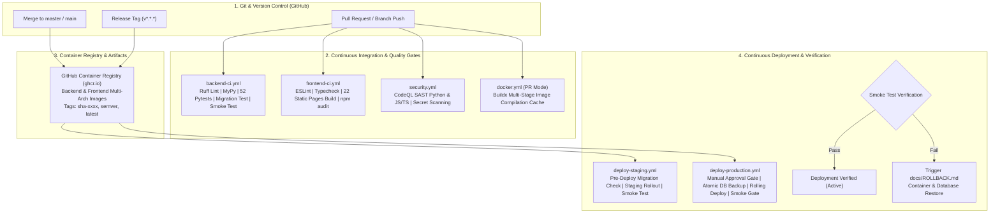

# EduPath AI — DevOps & CI/CD Architecture Overview

**Document Version:** 2.0.0-production  
**Author:** Principal DevOps Engineer & SRE Architect  
**Repository:** [https://github.com/hasinimaha2008/EduPath-AI-](https://github.com/hasinimaha2008/EduPath-AI-)  

---

## 1. Executive Architecture Summary

EduPath AI employs a decoupled, automated, and observable DevOps engineering ecosystem. Built around GitOps principles, container immutability, and zero-trust security, the platform guarantees that every push, pull request, and release is automatically audited, tested, scanned, and verified.

---

## 2. GitHub Actions Workflow Architecture

All workflows are maintained in `.github/workflows/` (and mirrored in `ci/workflows/`):

| Workflow | File | Triggers | Core Responsibilities |
|---|---|---|---|
| **CI Orchestrator** | [`ci.yml`](file:///.github/workflows/ci.yml) | Push / PR (`master`, `main`) | Top-level job coordination, concurrency cancellation of obsolete builds. |
| **Backend CI** | [`backend-ci.yml`](file:///.github/workflows/backend-ci.yml) | Changes in `backend/**` | Python compile, Ruff lint, MyPy check, 52 pytest tests, Alembic migration test, smoke test. |
| **Frontend CI** | [`frontend-ci.yml`](file:///.github/workflows/frontend-ci.yml) | Changes in `frontend/**` | `npm ci`, ESLint, `npx tsc --noEmit`, 22-route Next.js static build, `npm audit`. |
| **Security Scanning** | [`security.yml`](file:///.github/workflows/security.yml) | Weekly schedule / PR | CodeQL SAST scanning for Python and TypeScript/JavaScript. |
| **Docker CI & Publish** | [`docker.yml`](file:///.github/workflows/docker.yml) | PR (build only) / Push (publish) | Multi-stage Docker builds, BuildKit cache, GHCR publishing with commit SHA and semver. |
| **Deploy Staging** | [`deploy-staging.yml`](file:///.github/workflows/deploy-staging.yml) | Push to `master`/`main` | Pre-deploy migration dry-run, container deployment, automated smoke test. |
| **Deploy Production** | [`deploy-production.yml`](file:///.github/workflows/deploy-production.yml) | GitHub Release / Dispatch | Manual approval gate, pre-deploy DB backup, rolling update, post-deploy smoke gate. |
| **Release Management** | [`release.yml`](file:///.github/workflows/release.yml) | Push of `v*.*.*` tag | Release note generation, git SHA traceability, release asset attachment. |
| **Scheduled Maintenance** | [`scheduled-maintenance.yml`](file:///.github/workflows/scheduled-maintenance.yml) | Weekly Sunday 02:00 UTC | Database restore drill, upstream dependency freshness audit. |

---

## 3. Environment Topologies

| Environment | Host Architecture | Database Engine | Compose Manifest | Health Probes |
|---|---|---|---|---|
| **Development** | Local Docker / Bare-metal | SQLite WAL (`edupath_dev.db`) | [`docker-compose.dev.yml`](file:///docker-compose.dev.yml) | Port 8000 & 3000 exposed, hot reload |
| **Staging** | Cloud Container PaaS / VPS | Managed PostgreSQL / SQLite | [`docker-compose.yml`](file:///docker-compose.yml) | `/api/health/live`, `/api/health/ready` |
| **Production** | Isolated Cloud VPC / Kubernetes | Supabase / RDS PostgreSQL | [`docker-compose.prod.yml`](file:///docker-compose.prod.yml) | Decoupled liveness, Redis auth, internal networks |

---

## 4. Operational Documentation Map

- 🚀 **[CI/CD Architecture](CI_CD.md)**: Quality gates, pipeline concurrency, and local test runners.
- 🐳 **[Deployment Guide](DEPLOYMENT.md)**: Docker Compose orchestration and environment configuration.
- 🧪 **[Staging Operations](STAGING.md)**: Staging environment setup, pre-deploy checks, and smoke tests.
- 🏭 **[Production Operations](PRODUCTION.md)**: Manual approval gates, zero-downtime rolling deploys, and post-deploy gates.
- 🛡️ **[Security Architecture](SECURITY.md)**: STRIDE threat model, prompt injection defense, JWT auth, and non-root execution.
- 📈 **[Observability & Monitoring](MONITORING.md)**: Liveness/readiness probes, correlation IDs, and latency SLAs.
- 🗄️ **[Database Migrations](DATABASE_MIGRATIONS.md)**: Alembic versioning, schema compatibility, and test suites.
- 💾 **[Backup & Recovery](BACKUP_AND_RECOVERY.md)**: Cryptographic SHA256 sidecars, atomic restore, and corruption mitigation.
- 🔄 **[Rollback Runbook](ROLLBACK.md)**: Container revert procedures and database rollback.
- 🔧 **[Troubleshooting Guide](TROUBLESHOOTING.md)**: Root-cause diagnosis, error codes, and operational fixes.
