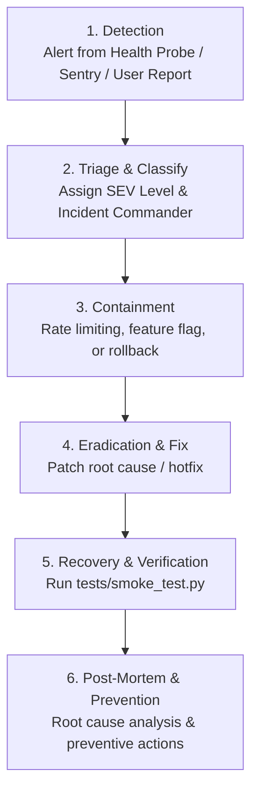

# EduPath AI — Production Incident Response Playbook

## 1. Severity Levels & SLA Matrix

| Severity | Definition | Target Response (MTTD) | Target Resolution (MTTR) |
|---|---|:---:|:---:|
| **SEV-1 (Critical)** | Core platform down; data loss imminent; severe security breach; all users impacted. | **$< 5$ minutes** | **$< 30$ minutes** |
| **SEV-2 (High)** | Major feature broken (e.g. AI Study Assistant unresponsive); significant subset of users impacted. | **$< 15$ minutes** | **$< 2$ hours** |
| **SEV-3 (Medium)** | Minor feature failure (e.g. avatar upload); performance degradation without outage; workaround exists. | **$< 1$ hour** | **$< 1$ business day** |
| **SEV-4 (Low)** | Cosmetic UI flaw; documentation inconsistency; non-blocking edge case. | **$< 1$ business day** | Scheduled Sprint |

---

## 2. Incident Response Workflow



---

## 3. Incident Runbooks

### Runbook A: AI Provider Quota Exhaustion or Outage
- **Symptom**: Gemini API returns HTTP 429 Quota Exhausted or HTTP 503 Service Unavailable.
- **Immediate Action**:
  1. The platform automatically engages its **internal deterministic pedagogical mode**.
  2. Verify that `/api/assistant/ask` continues to deliver grounded educational answers from internal knowledge templates.
  3. Rotate or update the Gemini API key dynamically via `POST /api/assistant/configure-key` or update `GEMINI_API_KEY` in `.env`.

### Runbook B: Database Write Lock or Concurrency Contention
- **Symptom**: Requests hang; `/health` returns HTTP 503 or error `database is locked`.
- **Immediate Action**:
  1. Check for zombie background worker processes:
     ```bash
     Get-Process python | Select-Object Id, ProcessName, CPU
     ```
  2. For SQLite: Verify WAL mode is active:
     ```sql
     PRAGMA journal_mode=WAL;
     PRAGMA busy_timeout=5000;
     ```
  3. If persistent corruption is detected, trigger atomic database recovery following [`docs/ROLLBACK.md`](ROLLBACK.md).

### Runbook C: High Ingress Traffic & Rate Limit Spike
- **Symptom**: High latency; legitimate users receiving HTTP 429 errors.
- **Immediate Action**:
  1. Verify Redis connectivity: `redis-cli ping`.
  2. Inspect sliding-window rate limit configuration in `app/core/config.py`.
  3. Temporarily adjust `RATE_LIMIT_PER_MINUTE` via environment configuration.

---

## 4. Post-Mortem Template

Every SEV-1 and SEV-2 incident requires a blameless post-mortem document completed within 48 hours containing:
1. **Incident Summary**: Date, duration, impact, and severity.
2. **Timeline of Events**: Chronological breakdown from detection to resolution.
3. **Root Cause Analysis (5 Whys)**: Underlying engineering root cause.
4. **Corrective & Preventive Action Items**: Tracked GitHub issues with assignees and target completion dates.
