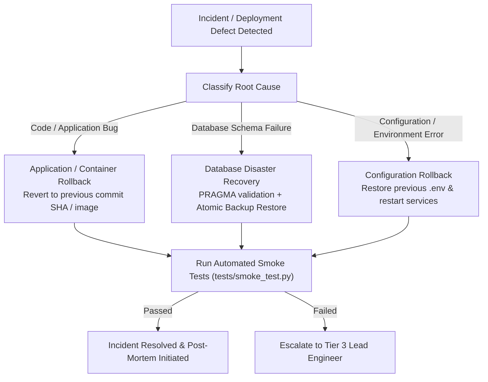

# EduPath AI — Production Rollback & Recovery Guide

## 1. Rollback Overview & Objectives

The primary objective of the EduPath AI rollback strategy is to restore service availability within **under 5 minutes** (RTO $< 5$ minutes) with zero data loss (RPO $= 0$) in the event of an erroneous release, migration failure, or critical infrastructure defect.



---

## 2. Emergency Rollback Triggers

A rollback is mandatory if any of the following conditions occur after a release:
1. **Smoke Test Failure**: Automated post-deployment smoke tests (`python tests/smoke_test.py`) exit with non-zero code.
2. **Readiness Probe Failure**: `/api/health/ready` returns HTTP 503 for more than 60 consecutive seconds.
3. **Elevated 5xx Error Rate**: HTTP 5xx responses exceed 1% of total API traffic within 10 minutes post-deploy.
4. **Latency Degradation**: End-to-end P95 latency exceeds 500ms on core study endpoints.
5. **Database Transaction Failure**: Database writes experience deadlock or unhandled schema constraint errors.

---

## 3. Container & Application Rollback Procedure

### Step 1: Identify Previous Stable Commit SHA
Find the last verified stable release commit from Git log:
```bash
git log --oneline -n 5
```

### Step 2: Roll Back Docker Compose Deployment
```bash
# 1. Check out previous stable commit
git checkout <PREVIOUS_STABLE_SHA>

# 2. Rebuild and deploy previous containers
docker compose up --build -d

# 3. Verify container startup
docker compose ps
```

---

## 4. Database Backup Restoration (Zero Data Loss)

Database backups in EduPath AI are protected with cryptographic SHA-256 sidecars and atomic rollback snapshots managed by [`backend/app/core/backup.py`](../backend/app/core/backup.py).

### Manual Database Restoration
To restore a verified database backup:
```bash
cd backend
python -c "
import asyncio
from app.core.backup import DatabaseBackupManager
async def restore():
    mgr = DatabaseBackupManager()
    # List available verified backups
    backups = mgr.list_backups()
    if not backups:
        print('No backups available.')
        return
    latest_backup = backups[0]['file_path']
    print(f'Restoring verified backup: {latest_backup}')
    success, msg = await mgr.restore_backup(latest_backup)
    print(f'Restore outcome: {success} - {msg}')
asyncio.run(restore())
"
```

### Safety Features During Restore:
1. **Cryptographic Checksum Verification**: The incoming backup's SHA-256 digest is compared against its `.meta.json` sidecar. Tampered or truncated files are rejected immediately without touching the live database.
2. **PRAGMA Integrity Check**: `PRAGMA integrity_check` and `PRAGMA foreign_key_check` are run against the backup prior to mounting.
3. **Emergency Pre-Restore Snapshot**: The current active database is backed up to `emergency_pre_restore_snapshot.db` before replacement.
4. **Atomic Rollback on Error**: If any step fails during restoration, the active database is atomically swapped back to the emergency snapshot.

---

## 5. Post-Rollback Verification Checklist

After executing a rollback:
- [ ] Verify `/health/live` returns HTTP 200 with status `"alive"`.
- [ ] Verify `/health/ready` returns HTTP 200 with status `"ready"` and all subsystems operational.
- [ ] Execute automated smoke test suite: `python backend/tests/smoke_test.py`.
- [ ] Confirm no orphaned background processes or locked database files exist.
- [ ] Document timeline and root cause in incident post-mortem.
