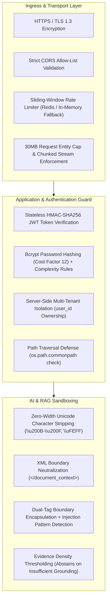

# EduPath AI — Application Security & Threat Model

## 1. Security Architecture & Threat Model

EduPath AI enforces a defense-in-depth security posture designed to prevent unauthorized access, prompt injection, data leakage, and infrastructure abuse across all tiers of the platform.



---

## 2. Key Security Mechanisms

### A. AI Prompt Injection & Sandbox Neutralization
- **Zero-Width Character Stripping**: Incoming queries and uploaded document text are cleansed of hidden non-printing unicode characters (`\u200B`–`\u200F`, `\uFEFF`, `\u202A`–`\u202E`) that could obfuscate jailbreaks.
- **Delimiter Escape Neutralization**: Any embedded closing tags matching `</document_context>` or `</untrusted_document_context>` are replaced with HTML entity equivalents (`&lt;...&gt;`), disarming boundary breakouts.
- **Evidence Density Enforcement**: Queries lacking sufficient semantic term overlap or sentence-level density trigger safe abstentions instead of fabricated hallucination.

### B. Multi-Tenant Data Isolation (IDOR Defense)
- **Database-Level Ownership Enforcement**: All endpoints accessing private resources (notes, quizzes, documents, chat histories) explicitly filter queries by `user_id == current_user.id`.
- Cross-tenant access attempts return HTTP 404/403 and are audited in security logs.

### C. Storage & File Upload Security
- **Path Traversal Defense**: All file uploads and downloads verify that `os.path.commonpath([UPLOAD_DIR, target]) == UPLOAD_DIR`, rejecting traversal attempts (`../../etc/passwd`) with HTTP 400.
- **Decompression Bomb Protection**: Archive files are inspected before extraction (`check_zip_bomb`) to enforce maximum uncompressed size limits and compression ratios ($\le 50:1$).
- **Magic Byte Validation**: Uploaded files verify magic byte headers (e.g. `%PDF-` for PDF) to prevent executable spoofing.

### D. Authentication & Session Security
- **Password Policy**: Enforces minimum 8 characters, requiring at least one uppercase letter, one digit, and one special character.
- **JWT Protection**: Tokens are signed using HMAC-SHA256 with secrets supplied strictly through environment variables.
- **Demo Login Production Restriction**: `/api/auth/demo-login` is disabled in production unless `ALLOW_DEMO_LOGIN=true` is explicitly set.

---

## 3. Automated Security Regression Testing

The test suite in [`backend/tests/test_security_regression.py`](../backend/tests/test_security_regression.py) contains 16 automated security tests verifying:
- CORS allowed and rejected origins
- Cross-tenant document, quiz, and chat history isolation
- Zip bomb decompression rejection
- Production demo login restriction
- Strict JWT tampering rejection
- Sliding-window rate limiting
- Zero-width space prompt injection neutralization
- XML boundary escape disarming
- Liveness and subsystem diagnostic probes

To run security regression tests:
```bash
pytest backend/tests/test_security_regression.py -v
```

---

## 4. Reporting Security Vulnerabilities

If you discover a security vulnerability within EduPath AI, please disclose it responsibly by opening a security advisory on GitHub or emailing security@edupath.internal. Please do not create public issues for unpatched vulnerabilities.
