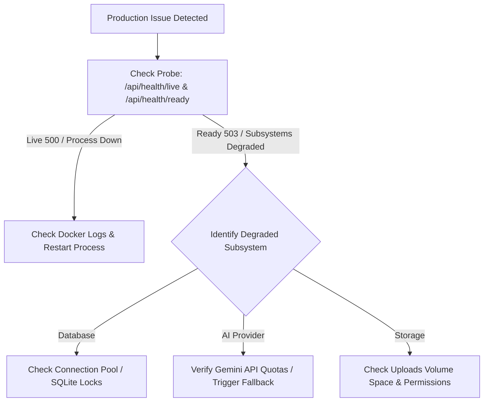

# EduPath AI – SRE Troubleshooting & Diagnostics Guide

**Document Version:** 2.0.0-production  
**Author:** Principal SRE & Support Specialist  

---

## 1. Quick Triage Flowchart



---

## 2. Common Failure Modes & Runbooks

### 2.1 GitHub Error: GH013 (OAuth App Lacks Workflow Scope)
- **Symptom**: `! [remote rejected] ... (refusing to allow an OAuth App to create or update workflow without workflow scope)`.
- **Root Cause**: The active GitHub Personal Access Token lacks administrative `workflow` permission.
- **Resolution**:
  1. Navigate to **GitHub > Settings > Developer Settings > Personal Access Tokens**.
  2. Select your active token, check the **`workflow`** scope checkbox, and save.
  3. Re-run `git push origin master`.

---

### 2.2 Docker Port Conflict: `port is already allocated`
- **Symptom**: `Bind for 0.0.0.0:8000 failed: port is already allocated`.
- **Root Cause**: A local instance of Uvicorn or another backend service is occupying port 8000.
- **Resolution**:
  ```powershell
  # Windows PowerShell
  Get-Process -Id (Get-NetTCPConnection -LocalPort 8000).OwningProcess | Stop-Process -Force
  ```
  ```bash
  # Linux / macOS
  lsof -ti :8000 | xargs kill -9
  ```

---

### 2.3 SQLite Concurrency Write Lock (`database is locked`)
- **Symptom**: `sqlite3.OperationalError: database is locked`.
- **Root Cause**: Multiple concurrent write transactions exceed SQLite's single-writer limit.
- **Resolution**:
  1. Ensure WAL mode is active:
     ```bash
     sqlite3 backend/edupath.db "PRAGMA journal_mode=WAL;"
     ```
  2. Checkpoint WAL log:
     ```bash
     sqlite3 backend/edupath.db "PRAGMA wal_checkpoint(TRUNCATE);"
     ```
  3. For multi-user concurrent traffic ($\ge 50$ concurrent writers), configure `DATABASE_URL` with external PostgreSQL.

---

### 2.4 External AI API Quota Boundary (HTTP 429)
- **Symptom**: `429 Resource has been exhausted (e.g. check quota)`.
- **Root Cause**: Google Gemini API requests per minute (RPM) or tokens per minute (TPM) limit reached.
- **Resolution**:
  EduPath AI automatically disarms this condition. The internal fallback engine intercepts API quota failures and returns structured, deterministic pedagogical guidance without terminating the student session. To switch keys, update `GEMINI_API_KEY` in `backend/.env` and reload the server.
